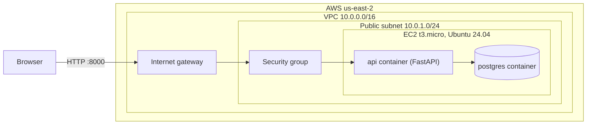
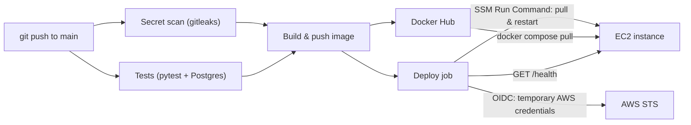

# Task Tracker API

[](https://github.com/syedalz/task-tracker/actions/workflows/build-deploy.yml)

A REST API for managing tasks, built with **FastAPI** and **PostgreSQL**, containerized with **Docker**, and delivered by a **GitHub Actions** CI/CD pipeline that tests, scans, publishes, and **automatically deploys** every change to **AWS**, on infrastructure defined in **Terraform**.

This project is a DevOps portfolio pipeline: the application is intentionally simple so the focus can be on how it is built, tested, packaged, and deployed.

## Architecture

How a request reaches the app once deployed:



How code gets from a commit to production:



## Tech Stack

- **Application:** Python 3.14, FastAPI, PostgreSQL 17, SQLAlchemy 2 (ORM), psycopg 3 (driver), Pydantic v2 and pydantic-settings
- **Testing:** pytest with FastAPI's TestClient
- **Containers:** Docker, Docker Compose, Docker Hub
- **CI/CD:** GitHub Actions, gitleaks, GitHub OIDC federation to AWS
- **Infrastructure:** Terraform, AWS (VPC, EC2, IAM, Systems Manager), IAM Identity Center

## API Endpoints

| Method | Path            | Description                                   | Success |
|--------|-----------------|-----------------------------------------------|---------|
| GET    | `/health`       | Health check                                  | 200     |
| GET    | `/tasks/`       | List tasks (`?limit=N`, default 10)           | 200     |
| POST   | `/tasks/`       | Create a task (`completed` defaults to false) | 201     |
| GET    | `/tasks/{id}`   | Get one task                                  | 200     |
| PUT    | `/tasks/{id}`   | Replace a task                                | 200     |
| DELETE | `/tasks/{id}`   | Delete a task                                 | 204     |

Requests for a task that doesn't exist return **404**. Interactive API docs are available at `/docs` while the app is running.

Example task:

```json
{
  "id": 1,
  "title": "Buy groceries",
  "description": "Milk, eggs, and bread",
  "completed": false,
  "added_at": "2026-11-10T19:00:00Z"
}
```

## Project Structure

```
task-tracker/
├── .github/
│   └── workflows/
│       └── build-deploy.yml  # CI/CD: scan, test, build, publish, deploy
├── app/
│   ├── main.py               # FastAPI app and router registration
│   ├── config.py             # Settings loaded from environment variables
│   ├── database.py           # Engine, sessions, and the get_db dependency
│   ├── models.py             # SQLAlchemy database models
│   ├── schemas.py            # Pydantic request/response models
│   └── routers/
│       └── task.py           # /tasks endpoints
├── tests/
│   ├── conftest.py           # Fixtures: test database, client, sample tasks
│   └── test_tasks.py         # API tests
├── infra/
│   ├── providers.tf          # Terraform settings and AWS provider
│   ├── main.tf               # Network, security group, key pair, EC2, SSM role
│   ├── data.tf               # Ubuntu AMI lookup
│   ├── variables.tf          # Input variables
│   ├── outputs.tf            # The instance's public IP
│   ├── userdata.tpl          # Instance bootstrap script (template)
│   └── bootstrap/            # Long-lived resources, applied once
│       ├── providers.tf
│       └── github.tf         # GitHub OIDC provider and least-privilege deploy role
├── Dockerfile
├── compose.yaml
├── .dockerignore
├── .env.example
└── requirements.txt
```

## Configuration

All configuration comes from environment variables, so the same code runs on a developer machine, in a container, or in the cloud without changes. Copy the example file and fill in your own values:

```bash
cp .env.example .env
```

| Variable            | Description                                       |
|---------------------|---------------------------------------------------|
| `DATABASE_HOSTNAME` | Database host (`localhost` when running locally)  |
| `DATABASE_PORT`     | Database port (default PostgreSQL port: 5432)     |
| `DATABASE_USERNAME` | Database user                                     |
| `DATABASE_PASSWORD` | Database password                                 |
| `DATABASE_NAME`     | Database name                                     |

`.env` is excluded from both Git and the Docker image; only `.env.example`, with placeholder values, is committed.

## Running with Docker Compose

```bash
cp .env.example .env          # then edit .env with your own values
docker compose up --build -d
```

This starts two services:

- **`api`**: the FastAPI app, on port 8000
- **`postgres`**: PostgreSQL 17, with data stored in the `postgres-db` volume

Then open http://localhost:8000/docs, or check the health endpoint:

```bash
curl http://localhost:8000/health
```

Useful commands:

```bash
docker compose ps             # service status (postgres should show "healthy")
docker compose logs -f api    # follow the API logs
docker compose down           # stop everything; data is kept in the volume
docker compose down -v        # stop everything and delete the database volume
```

## Running Locally (without Docker for the app)

```bash
python3 -m venv .venv
source .venv/bin/activate
pip install -r requirements.txt
fastapi dev app/main.py
```

This needs a PostgreSQL server reachable at the host and port in your `.env` (for example, a `postgres:17` container with port 5432 published).

## Running the Tests

Tests run against a **separate database**, `tasks_test`, so they never touch development data. Create it once in your local PostgreSQL server:

```sql
CREATE DATABASE tasks_test;
```

Then run:

```bash
pytest -v
```

Each test starts with freshly created tables, so tests are independent of each other and of the order they run in. The suite covers every endpoint's success and error cases, the `completed` default, the `limit` parameter, and edge-case input such as accented characters and long titles.

## CI/CD Pipeline

The GitHub Actions workflow runs on every push and pull request, with four jobs:

1. **`secret-scan`:** scans commits for leaked credentials with **gitleaks**, in parallel with the tests.
2. **`test`:** starts a PostgreSQL 17 **service container**, creates the test database, installs dependencies, and runs the full pytest suite. Database settings come from environment variables, with the password stored as a GitHub secret.
3. **`build`:** runs only if **both** `secret-scan` and `test` pass. It builds the Docker image and, on pushes to `main`, publishes it to Docker Hub tagged with `latest` and the **commit SHA**, so every published image can be traced back to the exact commit it came from. Pull requests build the image without publishing it.
4. **`deploy`:** runs after `build`, on pushes to `main` only:
   - **Signs in to AWS with OIDC.** GitHub issues a short-lived, signed token for the run, and AWS exchanges it for **temporary credentials** for a dedicated deploy role. No AWS access keys are stored anywhere.
   - **Finds the app instance** by its `Name` tag. If no instance is running (the environment is torn down between sessions), the job **skips cleanly** instead of failing.
   - **Deploys through AWS Systems Manager** (Run Command): the instance pulls the new image and restarts the app with `docker compose pull && docker compose up -d`. No SSH connection or open SSH port is involved. The job waits for the command to finish and fails if it fails.
   - **Verifies the deploy** by calling `/health` over the internet, retrying while the container restarts, and failing the job if the app doesn't respond correctly.

Required repository secrets: `DATABASE_PASSWORD`, `DOCKER_HUB_USERNAME`, `DOCKER_HUB_ACCESS_TOKEN` (a Docker Hub access token, not the account password), and `AWS_DEPLOY_ROLE_ARN` (the deploy role created by `infra/bootstrap/`).

## Deploying to AWS with Terraform

The infrastructure is split into two Terraform configurations with different lifecycles:

- **`infra/bootstrap/`:** long-lived resources, applied **once** and left in place. They cost nothing.
- **`infra/`:** the application environment, created when needed and **destroyed after each session** to keep costs near zero.

### `infra/bootstrap/`: the pipeline's identity in AWS

| Resource | Details |
|----------|---------|
| GitHub OIDC identity provider | Lets AWS trust tokens issued by GitHub Actions |
| Deploy role | Can only be assumed by workflows from **this repository's `main` branch**, verified using GitHub's immutable account and repository IDs |
| Deploy role permissions (least privilege) | Send commands **only to instances tagged `task-tracker-dev-app`**, only using the `AWS-RunShellScript` document; read command results; list instances |

### `infra/`: the application environment

| Resource | Details |
|----------|---------|
| VPC | `10.0.0.0/16`, with DNS support and DNS hostnames enabled |
| Public subnet | `10.0.1.0/24` in `us-east-2a`; instances get a public IP automatically |
| Internet gateway | The VPC's connection to the internet |
| Route table | A default route (`0.0.0.0/0`) to the internet gateway, associated with the public subnet |
| Security group | Inbound TCP 8000 from anywhere; inbound SSH (22) **only from the deployer's IP**; all outbound traffic |
| Key pair | Public half of a local SSH key (SSH is kept as a fallback; Session Manager is the primary access method) |
| IAM role and instance profile | Grant the instance `AmazonSSMManagedInstanceCore`, so it can be managed through Systems Manager |
| EC2 instance | `t3.micro`, the latest Canonical Ubuntu 24.04 image, 10 GB disk, bootstrapped with user data |

### How the instance sets itself up

On first boot, the instance runs `userdata.tpl`, a template rendered by Terraform's `templatefile()`. It:

1. Installs Docker and the Compose plugin from Docker's official repository.
2. Writes a Compose file to `/opt/task-tracker` that runs the **published image from Docker Hub** alongside PostgreSQL.
3. Writes a `.env` file with the database settings, with the password injected by Terraform from a variable, and restricts it with `chmod 600`.
4. Starts everything with `docker compose up -d`.

After that, new versions arrive through the pipeline's deploy job. User data runs only once, on an instance's first boot; after changing the template, replace the instance with `terraform apply -replace=aws_instance.app`.

### Prerequisites

- **AWS CLI** logged in through **IAM Identity Center** (temporary credentials; no long-lived access keys). The provider is configured for a profile named `admin`.
- **Terraform** installed.
- An **SSH key** at `~/.ssh/task-tracker-key` (`ssh-keygen -t ed25519 -f ~/.ssh/task-tracker-key`); only the `.pub` half is uploaded.
- An `infra/terraform.tfvars` file (excluded from Git) with your values:

```hcl
my_ip       = "203.0.113.25/32"   # your public IP, for SSH access
db_password = "a-strong-password"
```

Find your public IP with `curl https://checkip.amazonaws.com`.

### One-time setup: the pipeline's AWS identity

```bash
cd infra/bootstrap
terraform init
terraform apply
terraform output -raw github_deploy_role_arn   # save as the AWS_DEPLOY_ROLE_ARN repository secret
```

### Deploy, use, and tear down

```bash
aws sso login                   # renew AWS credentials
cd infra
terraform init                  # first time only: download the AWS provider
terraform plan                  # preview the changes
terraform apply                 # create the environment

terraform output app_public_ip  # the instance's public IP
```

After a few minutes (while the startup script finishes), open `http://<public-ip>:8000/docs`. From then on, every push to `main` deploys automatically.

To get a shell on the instance without SSH, use **Session Manager** (in the AWS console: Systems Manager → Fleet Manager, or the instance's **Connect** button). If the app doesn't come up, check `/var/log/cloud-init-output.log`, and `docker compose ps` / `docker compose logs` from `/opt/task-tracker`.

When finished (this leaves `infra/bootstrap/` in place):

```bash
terraform destroy
```

## Cost and Security Notes

- **Destroy after each session.** The network and IAM resources are free, but the instance and its public IPv4 address are billed hourly. Running everything for a few hours costs a few cents.
- **No long-lived AWS credentials anywhere.** Terraform and the AWS CLI use temporary credentials from IAM Identity Center; the pipeline uses temporary credentials from OIDC; the instance uses temporary credentials from its instance profile.
- **Least privilege.** The deploy role can run one kind of command on one tagged instance, and nothing else. Only the app's port is open to the internet; SSH is limited to a single IP address and isn't needed for deploys or access.
- **Secrets stay out of Git.** `terraform.tfvars`, Terraform state files, and `.env` are all gitignored, the database password variable is marked `sensitive`, and every push is scanned for leaked credentials.
- **Known limitations** of this demo setup: the API has no authentication, so anyone with the address can modify tasks; user data (including the rendered password) is visible to anyone with access to the AWS account; and the database lives on the same instance with no backups. The roadmap below addresses these.

## Design Decisions

- **Configuration through environment variables.** Database settings are read with pydantic-settings, following the Twelve-Factor App approach. Moving between environments only changes configuration, never code.
- **Isolated tests.** Fixtures use function scope, so every test gets a clean database. Test data is inserted directly through the database session rather than through the API, so a bug in one endpoint can't break tests for another.
- **A small, reproducible image.** The Dockerfile uses a pinned `python:3.14-slim` base image, installs dependencies before copying the source code so code changes don't trigger a full reinstall, and uses `.dockerignore` to keep the virtual environment and `.env` (with its secrets) out of the image.
- **Container networking.** The API listens on `0.0.0.0` so it can accept connections arriving from outside its container, and reaches the database by its Compose service name (`postgres`).
- **Startup ordering.** The `postgres` service has a health check using `pg_isready`, and the `api` service waits for it with `depends_on: condition: service_healthy`.
- **Deploy what was tested.** The instance runs the image published by the pipeline rather than building from source, and only images from commits that passed the tests and the secret scan are published.
- **Keyless, least-privilege deployments.** The pipeline authenticates with OIDC instead of stored access keys, and deploys through Systems Manager instead of SSH, so there is no deploy credential to leak and no inbound port to open for deployments.
- **Verified deploys.** A deploy only counts as successful once the live app answers its health check.
- **Separate lifecycles.** Long-lived identity resources live in `infra/bootstrap/`, so the application environment can be destroyed and recreated freely without breaking the pipeline.
- **Trustworthy machine images.** The Ubuntu AMI is looked up dynamically, filtered to Canonical's official publisher account, so the instance always starts from the latest genuine image.
- **Infrastructure as code.** The whole environment is defined in Terraform, so it can be rebuilt identically in minutes and removed completely with one command.

## Roadmap

- [x] REST API with PostgreSQL
- [x] Automated tests with pytest
- [x] Docker image and Docker Compose setup
- [x] CI pipeline with GitHub Actions (run tests, build and publish image)
- [x] AWS infrastructure with Terraform (VPC, security group, EC2)
- [x] Secret scanning in the CI pipeline (gitleaks)
- [x] Continuous deployment to EC2 with OIDC, Systems Manager, and a post-deploy health check
- [ ] Deploy a specific image version by commit SHA (enables rollbacks)
- [ ] Remote Terraform state in S3 with locking
- [ ] Secrets in AWS Systems Manager Parameter Store instead of user data
- [ ] Monitoring and alerting with CloudWatch
- [ ] Managed database (RDS) in a private subnet
- [ ] Load balancer with HTTPS
- [ ] Kubernetes deployment
- [ ] Database migrations with Alembic
- [ ] PATCH endpoint for partial updates